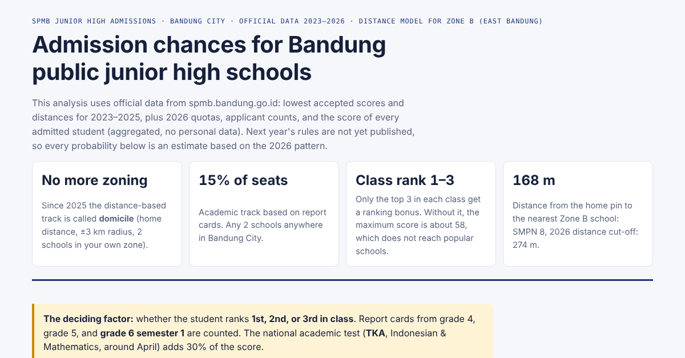

# Bandung SPMB Admission Predictor

An interactive dashboard and a simple probabilistic model that estimate a student's chance of admission to Bandung's 75 public junior high schools (SMP Negeri), built from official SPMB admission data for 2023–2026.

**Live demo:** https://rendynoa.github.io/Prediksi-SPMB-SMP-Bandung/

## Background

Since 2025, public school admission in Bandung runs through SPMB (Sistem Penerimaan Murid Baru), which replaced the former PPDB. The zoning track became a "domicile" track, and from 2026 the report-card track also counts the national academic test (TKA). News coverage of the rules was incomplete, while the underlying data is openly available on the official portals.

This project started from a real need: helping a family choose an enrollment strategy (report card, competition certificates, or home distance) based on data rather than word of mouth.

## Features

- **Report-card calculator**: grades per subject per semester, class rank, and TKA (Indonesian and Mathematics), scored with the official 2026 formula.
- **Merit-track probabilities** (report card or competition) for all 75 public junior high schools, with automatic "reach + safe" recommendations or manual school choice.
- **Competition certificate scoring** from the official 2026 score table.
- **Domicile-track simulator** for the 19 schools in Zone B (east Bandung), based on 2023–2026 distance cut-off trends.
- **Senior high outlook**: 2026 West Java SPMB data for 27 public senior high schools in Bandung.
- **Excel workbook** with the same model in live formulas and editable assumptions.

## Repository contents

| File | Content |
|---|---|
| `index.html` | Interactive dashboard (single file, no server) |
| `Bandung_SPMB_Admission_Predictor.xlsx` | Workbook: sources & method, calculator, per-school data |
| `data/smp_kota_2026.csv` | 75 junior high schools: location, quotas, applicants, report and competition cut-offs 2026 |
| `data/smp_wilayah_b_domisili.csv` | 19 Zone B schools: domicile distance cut-offs 2023–2026, report cut-offs 2023–2025 |
| `data/sma_kota_2026.csv` | 27 senior high schools: quotas, report cut-offs, domicile distance cut-offs 2026 |
| `data/skor_kejuaraan_2026.csv` | Competition certificate score table |

## Data sources

- [spmb.bandung.go.id](https://spmb.bandung.go.id): 2023–2025 recapitulation, school info, 2026 Round 1 and Round 2 selection results, and the official SPMB 2026 guide.
- [spmb.jabarprov.go.id](https://spmb.jabarprov.go.id): final 2026 standings for public senior high schools in Bandung.

Data was collected in October 2026 from public pages. The repository stores **only per-school statistics** (quotas, applicant counts, lowest/median/highest admitted score or distance). No student names or personal data are included.

## Method

- **Report-card score (2026 guide):** `NA = 70% × (40% × mean of 8 subjects + rank bonus) + 30% × TKA`, where the rank bonus is `60 − (60/28) × (rank − 1)` for ranks 1–3 and 0 otherwise. The formula was checked against the scores of students actually admitted in 2026. This showed the real report-card weight is 40%, not the 50% reported in the news.
- **Report-card probability:** the student's score is compared with each school's lowest admitted score in 2026, with normal uncertainty for the TKA (±7 points) and for year-to-year cut-off shifts (±1.8 points at selective schools).
- **Competition probability:** the highest certificate score is compared with the lowest admitted competition score in 2026.
- **Domicile probability:** next year's distance cut-off is modeled as log-normal from the 2023–2026 cut-offs (weights 5/15/25/55%).
- **Combined probability:** `1 − (1 − P1)(1 − P2)`, treating choices as independent.

## Limitations

- The report-card formula with TKA has only one year of history (2026), so the model cannot yet be backtested.
- Distance cut-offs at newer or smaller schools can swing sharply between years.
- Next year's applicant behavior cannot be predicted.
- "Sought-after" here means selective (cut-off and demand), not a measure of teaching quality.
- Rules may change. Read the percentages as bands (high / medium / low), not exact values.

## Disclaimer

Independent project. Not affiliated with the Bandung City or West Java Education Offices. Always check the latest rules on the official SPMB portals.

## Tech

HTML, CSS, and vanilla JavaScript (no framework), Excel (`NORMSDIST`, `INDEX/MATCH`), Python (data processing and workbook generation).

## License

Code is released under the MIT License (see `LICENSE`). Data comes from official government portals and remains subject to their terms.
